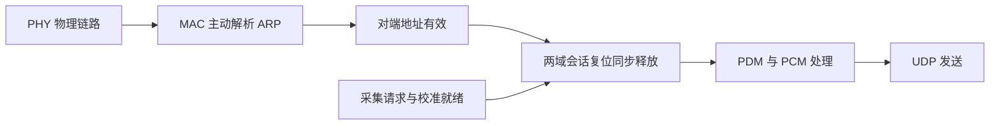

# 等待 ARP 就绪后启动采集

> 历史记录：2026-09-19 四路 CLK / 3.3 V ARP 修正版；157,314,048 样本实测仅属于该版。正文中的“当前/本次/下一步”指当时状态。当前推荐位流与未完成实板项目见[最新发布报告](clk8_18v_update.md)，版本关系见[版本历史](version_history.md)。

2026-09-19：修正前实板在模式切换时丢失 24 个 PCM 帧，UDP 序号连续且样本数值正确，定位为 FPGA 在等待 ARP 时发送队列溢出。原始证据见 [实板测试报告](uart_board_test_20260919.md)。

## 修改后的行为

物理链路建立后，MAC 不等 PCM 首包便主动发送 ARP，并在无应答时重试。对端地址有效后，采集请求才允许两个时钟域的会话复位同步释放。这样即使主机迟迟不应答，前端也不会产生需要缓存的采样帧。

模式切换将 UDP 会话暂停，丢弃旧的半包并完成帧间隔；ARP 收发与缓存继续属于物理链路。新模式重新加载校准后沿用已解析地址，PCM 帧号从规定起点重新连续输出。物理断链或系统复位仍清除地址，并重新完成解析。

`ethernet_udp_engine.sv` 新增独立 `stream_enable` 和 `peer_ready` 接口，UDP 清空不再等同于物理断链。`mems_ethernet_core.sv` 用 `run && link_up && peer_ready` 作为两侧 FIFO 共同的异步复位资格，并沿用各域三级同步释放。ARP 先于 PCM 发起，避免双方互相等待的死锁。外部顶层引脚、采样率、滤波计算、UDP 格式及 SYS3 字宽不变；SYS3 word21 bit1 现在表示 MAC 物理链路，bit15 仍表示采集会话释放。

## 功能验证

12 项完整回归通过；增加布局阶段的数据库衔接检查后，116 项发布检查器测试通过。证据：`log/full_regression.json`、`log/system_uart/arp_fix_full_regression_console.log`、`log/system_uart/arp_fix_split_checker_tests.log`。

| 场景 | 结果 |
|---|---|
| 没有 PCM 输入、采集关闭时 ARP 请求与重试 | PASS |
| ARP 应答延迟 0.65 ms / 2 ms | 等待期间无采集/溢出；每会话 53 包、159 帧连续，缺帧 0 |
| 完整系统模式切换 | 保留对端地址、不重新请求 ARP；两级 BIST 通过，启动丢帧 0 |
| 发送中关闭会话 | 取消旧 UDP，保持帧间隔及 ARP 服务，下一会话无旧错误 |
| 物理断链、音频停钟、PLL 复位 | 两侧 FIFO 正确复位，重新解析地址与启动 |
| 已建链后人为阻塞发送 0.65 ms | 按设计丢弃整帧：17 帧缺口与计数一致，保护能力保留 |
| 独立模型比对 | 完整核心 152 包、58,368 个通道样本逐位一致；板级内部自测另比对 15,360 个样本 |

延迟 ARP 后的零丢帧与故意超长背压时的丢帧是不同的验证场景，不能把第三个会话的保护测试误认为修正后仍有启动丢帧。

## 物理实现与发布

首轮 `fpga/build/MEMS_Array_uart_arp_ready` 完成布线，但音频域有 2 个同步复位路径 setup 违例，WNS=-0.014 ns，TNS=-0.028 ns；预位流检查 FAIL，未生成位流。路径从 `core/audio_reset/release_pipe[2]` 到 CIC lane2 两个结果寄存器 RS，数据延迟中布线占 93.4%，不是 PCM 算术路径。首轮 recipe 快照及失败报告原样保留。

当前构建目录为 `fpga/build/MEMS_Array_uart_arp_ready_routed`，启用 PDS 官方的优先布线自动迭代，最多 2 轮，选择 setup 裕量低于 +0.050 ns 的最多 8 条路径。此选项生成物理布线优先指令，不改变 RTL、时钟、SDC 时序要求或发布检查。RTL/模型/测试源码哈希仍与已通过的 12 项回归完全一致。PDS 2022.2 的迭代入口要求 PLC 数据库；直接输入 MAP 的 `MEMS_Array_uart_arp_ready_iter` 尝试已被工具拒绝。正式脚本新增真实的 `pnr -place_only` 阶段，复制本轮 PLC 为只供下阶段读取的输入并校验哈希。发布检查器同时要求对应原生成功记录、阶段顺序、脚本哈希和 map → placement → route 数据库路径正确；10 项新增正反例通过。

自动布线第一轮准确复现 -0.014 ns 违例，生成 4 条 `def_route -prior_net` 指令，覆盖复位释放、共享反相控制线以及 CIC 分支到两个结果寄存器 RS 的连接。第二轮将最差 setup 裕量改善到 +0.118 ns。指令及工具执行记录保存在 `place_route/all_route_constraint_ite.rcf` 和 `build.log`。布局用时 4 分 9 秒，两轮布线动作分别为 13 分 31 秒、16 分 11 秒；全流程从 13:31 到 14:13 完成。不得将最后一轮工具计时误报为整个两轮流程耗时。

| 项目 | 结果 |
|---|---|
| 正式构建 / 发布 | `fpga/build/MEMS_Array_uart_arp_ready_routed` / [release.json](../../fpga/build/MEMS_Array_uart_arp_ready_routed/release.json)：PASS，`release_authorized=true` |
| 完整双角时序 | All Constraints Met；setup/hold 违例 0 |
| 音频慢角 setup / hold | +0.118 / +0.050 ns |
| 音频快角 setup / hold | +1.667 / +0.018 ns |
| RGMII 实际最大相对偏差 | 0.274 ns，小于 0.300 ns 预算 |
| PDM 最小预算余量 | 7.922 ns |
| 输入一致性 | RTL/时序约束/宏位置模板未变；map → placement → route 哈希校验通过 |
| 下载位流 | [mems_array_pg2l200h.sbit](../../fpga/build/MEMS_Array_uart_arp_ready_routed/generate_bitstream/mems_array_pg2l200h.sbit)，9,188,552 字节 |
| SHA-256 | `a5e591810e2e9855a1fb9ce4d14495da2d8babeb791bad667de825e0bf71fce3` |

发布范围仍为工程上板联调；真实 TXC 占空比/抖动及接满阵列后的麦克风时钟电气测量不由这次数字测试替代。

## 实板验证结果

2026-09-19 14:15，官方 JTAG CLI 下载成功，PG2L200H ID=`0x00603899`，DONE=1，编程用时 **8.7 秒**。本次采用 `program=1`，扫链后设置 `10Mhz`；此前数分钟的下载耗时未复现，但未分别做单变量实验来归因。仅下载 CRAM，没有写 Flash/eFuse。

原始证据目录：[arp_ready_board_20260919_131002](../../log/system_uart/arp_ready_board_20260919_131002/)。汇总 [board_result.json](../../log/system_uart/arp_ready_board_20260919_131002/board_result.json) 为 **PASS_ARP_FIX_AND_INTERNAL_PDM**，12 项证据条件均通过，分析脚本退出码 0。

| 场景 | 实测结果 |
|---|---|
| UART | 165 条有效 SYS3，解析错误/丢记录/会话异常/命令接收错误均 0 |
| 时钟与 PHY/MDIO | 三 PLL/各域状态健康；PHY ID=001CC916，地址 1，配置步骤 27，1 Gbit/s 全双工，重试 0、故障 0 |
| ARP 等待保护 | 4 条新鲜状态（跨度 750 ms）显示 LinkUp=1、PeerValid=0 时 Acquiring=0；DroppedFrames=0、Overflow=0 |
| 启动数据 | 217,837 个自检 UDP 包，653,511 帧，83,649,408 个通道样本逐位一致；从包序号 0、帧号 96 开始，缺帧 0、错误标志 0 |
| 自检 → 真实输入 → 自检 | 新 epoch 3、4 均从包 0、帧 96 开始；3 个会话在捕获范围内包序号/帧号均连续 |
| 切换后的自检数据 | 191,835 个自检包，575,505 帧，73,664,640 个样本逐位一致；缺帧/错误标志 0 |
| ARP 缓存保留 | 模式切换期间 ARP-only PCAP 无帧；UART 请求数保持 2、接受数保持 1、PeerValid 持续有效 |
| FPGA 两级 BIST | 启动和切回自检后均 PASS，无本地或 TX 自检失败 |
| PC 接收 | 两次数据核验均无主机队列丢弃、非法包或未保存包 |
| 恢复真实采集 | 最终 epoch 5，121,654 个真实模式包、364,962 帧连续；网络丢帧/溢出 0，但数据饱和，见下节 |

两次独立自检捕获共核验 **157,314,048 个通道样本**。旧版启动/切换的 24 帧缺口不再出现。实板复位测试由 UART `r` 触发，覆盖 PHY 重建及 ARP 再解析；本轮没有做人工拔插网线。PC ARP 时间戳只代表主机捕获点，不代表完整 FPGA 往返时延。

## 外部麦克风输入仍待核对

恢复真实输入后，所有 128 路在本次捕获的 **46,715,136 个样本中均为 +8,388,607（0x7FFFFF）**，UDP flags=1（饱和），UART `Clipped=true`；与此同时 `DroppedFrames=0`、`Overflow=false`、`ProcessingError=false`，包序号和帧号连续。

该现象与内部 PDM 自检通过并存，下一步应先确认阵列接入和供电、DATA/CLK 连线及 PDM 数据翻转。持续为高的数据输入等情况可能产生这种饱和，但仅凭 PCM 结果不能断言引脚电平或根因。当前尚未获得阵列连接状态的确认，不修改增益或屏蔽饱和标志来掩盖输入问题。

证据：[normal_input_analysis.json](../../log/system_uart/arp_ready_board_20260919_131002/normal_input_analysis.json)、`pcm_final_normal.*`、`uart_final_normal/`。板卡最终保持**真实麦克风模式**，COM3 已关闭；真实麦克风接线、采样时序与声学性能尚未验收。

修改前源文件和回归摘要保存在 `log/archive/pre_arp_ready_20260919_1249`，旧 `MEMS_Array_uart_chain8` 位流及实板失败证据保留。
