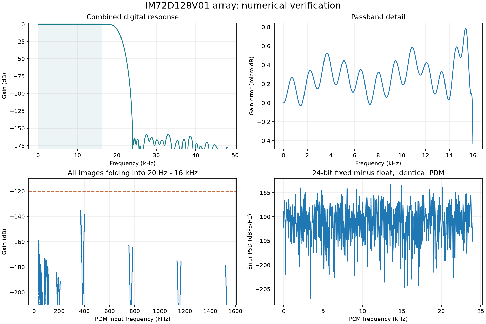

# 前处理链性能仿真报告

本报告由 `lib/model/performance.py` 自动生成。结果使用实际 Q2.30 系数；浮点 Golden Model 与定点模型使用同一批 PDM，独立隔离数值误差。采样率 48 kHz，验收频带 20 Hz～16 kHz。

| 检查项 | 实测 | 验收门限 |
|---|---:|---:|
| 通带峰峰纹波 | 0.000001211 dB | < 0.01 dB |
| 折入通带的最差镜像抑制 | 135.156 dB | > 120 dB |
| 24 位输出相对浮点误差，全部 PCM 频带 | -146.329 dBFS RMS | < −135 dBFS |
| 数值误差，20 Hz～16 kHz A 计权 | -149.396 dBFS(A) | 计入噪声预算 |
| 内部 Q2.30 相对浮点误差 | -186.751 dBFS RMS | 记录 |
| 二阶白量化误差假设下的混叠噪声 | -175.965 dBFS(A) | 模型估算 |
| 数值误差估计导致的 SNR 损失 | 0.000315 dB | < 0.1 dB |
| 叠加上述混叠模型后的 SNR 损失估计 | 0.000316 dB | < 0.1 dB |
| 公共群延迟 | 743.977865 μs | 全通道一致 |
| 脉冲响应长度 | 4568 个 PDM 周期 | 小于 96 个 PCM 帧 |

## 方法及适用范围

- dBFS 采用满幅正弦 RMS = 1/√2 的基准。没有把 72 dB(A) SNR 当作相对满量程 −72 dBFS；手册 −36 dBFS 灵敏度与 72 dB(A) SNR 对应约 −108 dBFS(A) 本底。
- 镜像扫描覆盖 0～1.536 MHz，步长 5.859375 Hz，检查折入 20 Hz～16 kHz 的所有非基带频率。离散频率扫描不是区间数学证明。
- 两级 FIR 都对称，量化后仍严格对称；系数量化的最大复频响误差 1.038e-08，相对相位误差 9.628e-14°。同系数、同调度、同复位的通道具有完全相同的数字延迟。
- 生成 262144 个 PDM 周期，含 −36 dBFS、1 kHz 主信号和 7 kHz 小信号；丢弃前 96 个 PCM 帧。二阶 PDM 发生器仅用于合成激励，不代表 Infineon 内部 ADC。
- 混叠估算明确采用 Δ=2、误差方差 Δ²/12、二阶 NTF=(1−z⁻¹)²，积分全部 63 个非基带镜像；无法由这项假设保证真实麦克风的混叠噪声。需要实际 PDM 录音或厂家噪声谱来最终验证。
- 16～24 kHz 不属于保证通带；缩小带宽只用于声源定位，不宣称完整保留手册 20 kHz 带宽下的声学频响。
- RTL 一致性、饱和、启停及输出阻塞结果见 `verification.md` 与工程 `log/`；没有器件综合、布局布线或声学台架测试数据。
