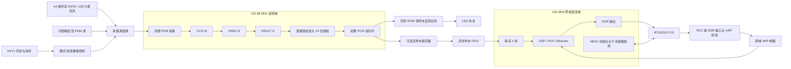

# RTL 微架构与吞吐预算

前处理顶层为 `rtl/mems_array_top.sv`。这一部分使用同一个 122.88 MHz 系统时钟；3.072 MHz `mic_clk` 只是送往麦克风的输出时钟，不作为内部逻辑时钟。复位为系统时钟采样的低有效复位。完整系统使用 `rtl/board/mems_array_pg2l200h.sv`，在此前处理之外加入独立125MHz网络域和PHY接收域。

音频域产生帧号和通道号，跨域与网络链路只传递这些标记，不重新定义采样时刻。上电先完成校准和 PHY 初始化；千兆链路建立后才启动 PDM。断线时共同复位采集会话和跨域队列，重连后重新等待麦克风与滤波器稳定。

| 模块 | 职责 | 周期或调度 |
|---|---|---|
| pdm_capture | 时钟生成、50 ms 等待、64 线双相收集 | 每 40 clk 给一个 128 位向量 |
| cic_decimator | 32 位 CIC5 /8 | 8 lanes × 16 组，积分器每位一次；差分另用 5 级流水 |
| fir_decimator，FIR1 | 63 taps 补偿 /4 | 16 lanes × 8 组，每组 63+4 clk；输出周期 1280 clk |
| fir_decimator，FIR2 | 127 taps 低通 /2 | 16 lanes × 8 组，每组 127+4 clk；输出周期 2560 clk |
| pcm_calibration | 128 组增益/偏置、舍入饱和 | 一条乘法流水，128 通道依次处理 |
| pcm_frame_fifo | 缓存和串行输出 | 4 帧 × 128 通道，ready/valid，每帧连续通道编号 |

## CIC 状态调度

物理 lane l 处理通道 `group×8+l`，每个 PDM 向量在 16 个系统周期内完成 128 通道积分器更新。5 个积分器使用旧前级状态，避免把五个加法器串接在一个周期内。抽取周期产生的差分数据通过 5 个流水级，各级携带 group 标签；只有最后一组写回后才统一置 `valid_o`。

位宽固定为 32，CIC 约 40960 bit 的逻辑积分/差分历史状态；8 lanes 共 40 个 32 位积分加法器、40 个 32 位差分减法器。历史数组采用异步读、同步写、不复位的 RAM 描述，另用 96 个共享行有效位在每次复位后把未写行读作零；复位期间禁止写 RAM。这样保持原有运算、抽取相位与输出周期，同时允许综合为分布式 RAM。PG2L200H 的独立综合已确认 720 个 RAM32X2DP 原语；实际状态位宽会因输出左移截位被工具优化。完整 32 位状态、反复复位以及厂商综合网表的逐周期等价结果保存在 `fpga/build/cic_ram_alternative/`。

## FIR 双端口存储和乘加调度

每条 lane 有独立历史 RAM，通道组作为地址高位、环形样本位置作为低位。输入完整向量先锁存，8 个系统周期依次写入各组。读取和写入分属两个端口。每个 FIR 输出任务冻结 base_pointer 和有效历史长度，然后逐组遍历全部 taps。

流水线为“同步 RAM/系数读取 → 四个16位部分乘积 → 中间段进位合成 → 完整64位乘积 → 72位累加 → 最终舍入饱和”。拆分乘法避免在PG2L200H中把多个APM串成一个长组合路径，完整乘积没有截位。每组 taps+4 个系统周期，最终写回再加1拍，因此 FIR1 计算537周期、FIR2计算1049周期；另有输入写入和模块握手开销。分别小于1280、2560周期的任务间隔。

舍入采用算术商加进位的精确等价式：`q=sum>>>30`，`inc=sum[29] && (!sum[71] || |sum[28:0])`，以保持正负半LSB远离零舍入。新增流水只改变处理延迟，滤波系数、抽取相位、PCM帧号及样本值保持不变。

按输入完整有符号32位范围和冻结系数的绝对值和，两级累加绝对值上界分别为3492496714516922368、4567272672152518656，均小于2^62，因此42位舍入商有充分余量。修改系数集或定点格式后必须重新核对这一界限。

FIR1 历史深度 128，FIR2 为 256。FIR1 计算期间可能有新的 384 kHz 输入到达，环形存储留出足够覆盖余量，避免将当前任务仍需读取的最老样本覆盖。**仅改变 LANES 或 DEPTH 不能自动保持这个保证**，修改时必须重新计算最坏处理时长、输入写入间隔和覆盖余量。

RAM 不做复位清零，通过 `job_history` 把尚未写过的样本置零。这样启停可重复，并保留 FPGA RAM 推断机会。两级 RAM 容量分别 524288 和 1048576 bit，合计 **192 KiB**；bank 分割和器件颗粒会影响实际 RAM 使用量。

两级共 32 条 32×32 乘加流水，校准另有一条 33×24 乘法流水。这里的“33 条乘法流水”**不是 33 个物理 DSP**：真实 FPGA 常需要多个 DSP 实现一个这样宽的乘法器，必须以目标器件综合报告为准。

校准将完整57位乘积右移29位并舍入，同样采用算术商加进位：`q=product>>>29`，`inc=product[28] && (!product[56] || |product[27:0])`。28位商扩为29位后加进位，再做24位饱和，避免长的绝对值/加偏置/再次取负组合路径。该等价变换不增加流水级；UT用独立的有符号幅值公式核对20,056个全宽乘积及半LSB边界，再检查真实128通道校准和整条数据链。

## 输出、阻塞与异常

PCM 总吞吐为128×48000 = 6.144 Msamples/s，24位有效载荷147.456 Mbit/s。122.88 MHz单样本接口只需要平均5%的时钟完成握手。完整系统先用一级100位可反压寄存器隔开帧RAM读出与跨时钟RAM写入，再经100位×1024深度异步FIFO进入网络域。该级同时保持数据、帧号、通道号和状态；下游阻塞时全部保持，掉线时随同FIFO清空。它增加一拍传输延迟，不改变采样时间轴、滤波器相位或包内帧号。三帧组成一个1208字节UDP包，含线路开销163.072Mbit/s。网络架构与协议见 [transport_spec.md](transport_spec.md)。

FIFO 是以整帧为单位的环形队列。一个正在发送但尚未发送完的帧仍占据一个槽位。FIFO 满时，采集和滤波继续，新到的整个帧被丢弃，旧帧及已开始输出的帧保持完整；下一个成功输出帧的帧号可显示缺口。满队列与最后一个样本出队同周期发生时，允许新帧利用释放的槽位。

`overflow` 和 `dropped_frames` 记录输出阻塞。`processing_error` 表示 CIC/FIR/校准调度过载，在默认结构和时钟下正常运行不会置位；一旦置位，应停止本轮处理、重新启动，不能继续把后续帧当成完整连续录音。

## 按键自测

`pdm_selftest_source` 在与采集器相同的音频域观察 `mic_clk` 的上升沿，逐 PDM 周期生成128路确定性bit，并按高/低槽复用成64线。源切换位于采集同步器之前，完整前处理链保持工作。`pcm_selftest_checker` 使用同步读取的2048×24位预期ROM，每次PCM握手同时核对值、通道、frame_id、first/last；比较与ROM读出分拍。预期表由独立Python/C++模型交叉生成，稳态16帧重复。

`board_selftest_control` 同步KEY1并作20ms消抖，持续按下只触发一次。切换模式即撤销run，128路校准完成后再允许启动。自测统一校准为单位增益/零偏置；正常模式使用原ROM。跨域的模式和故障均为稳定电平，两级同步；网络域直接计数完整UDP发送事件，避免跨域传递单周期脉冲。每个流重启清空自测源、比较器和发送计数，板级故障灯另锁存至退出自测或全局复位。

板级新增KEY1(C23)及LED0～4(A20/C19/C18/E18/A17)，总计93个约束端口。接口模式、超时和显示定义见 [selftest.md](selftest.md)；线上自测标志及软件预期表见 [host_protocol_reference.md](host_protocol_reference.md)。

## 可移植性边界

前处理和 `rtl/net` 不实例化 FPGA 厂商 IP，系数以显式 ROM case 提供，不依赖仿真工作目录加载系数。`rtl/board` 单独放置 Pango GPLL、DDR和IO封装。生产参数固定为128路、48kHz；子模块参数用于结构复用及UT，仿真缩短启动参数不能带入生产配置。

PG2L200H目标工程与约束位于 `fpga`。实现资源、布局布线和位流状态应以该目标的最终报告为准。旧的可选 `sim/elaborate.tcl` 只检查可移植RTL展开，不用于目标器件实现。
