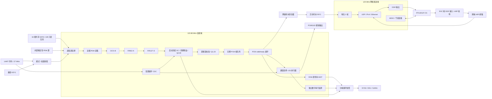

# RTL 微架构与吞吐预算

前处理顶层为 `rtl/mems_array_top.sv`。这一部分使用同一个 122.88 MHz 系统时钟；3.072 MHz `mic_clk` 只是送往麦克风的输出时钟，不作为内部逻辑时钟。复位为系统时钟采样的低有效复位。完整系统使用 `rtl/board/mems_array_pg2l200h.sv`，在此前处理之外加入独立 125 MHz 网络域、PHY 接收域和 27 MHz UART 观察域。板级将同一 PDM 时钟复制到八个物理输出，使用 LVCMOS18；可移植前处理顶层仍只有一个公共时钟输出。

当前已发布并下载版本为[FIR8](reports/i2s_fir8_auto_20261011.md)。18层功能、实际映射、唯一一轮路由与严格快/慢角时序通过，16:19:06完成JTAG SRAM下载；新版本次A–E数字验收通过，联合结果为PASS_WITH_KNOWN_ISSUES；F真实采样连续，DATA1/ch2、3及物理未测边界保留。以下按每级8-lane说明结构，前一[seed3基线](reports/i2s_parity_dc_roundsat_seed3_20261011.md)为16-lane，其实测保留为历史。DATA1/ch2、3和物理验收边界不变。算法合同见[v1.2](algorithm_spec.md)。

音频域产生帧号和通道号，跨域与网络链路只传递这些标记，不重新定义采样时刻。可移植网络内核默认 `INDEPENDENT_AUDIO=0`：校准、千兆全双工链路和 ARP 对端均就绪后才启动 PDM，断线时清空采集会话与网络队列，重连后重新等待麦克风和滤波器稳定。

完整板级设置 `INDEPENDENT_AUDIO=1`、`DC_ESTIMATE_LOG2=12`：正常模式完成 ROM 装载后启动真实 PDM，完成预热、滤波稳态和 DC 训练，从 frame_id=4192 释放 PCM。没有 PHY 链路或 ARP 对端时也完成训练并供 I2S 监听，网络队列保持复位。网络就绪后从下一完整帧入队；断线只清网络，冻结 DC、真实音频与前端帧号继续。`acquisition_active` 和 SYS3 同名状态仍描述网络流释放，不能单独判断 I2S 工作；网络反压仍可能影响共享 PCM 握手。

模式切换保留 ARP 缓存，但停止前端、清空旧流和 DC 有效性，重载 128 路校准。BIST 使用网络门控、DC=0、奇偶增益=1，保持从第 96 帧开始的原黄金序列；退出后重训真实 DC。物理断链清 ARP 并重启 BIST，正常真实前端则继续。

| 模块 | 职责 | 周期或调度 |
|---|---|---|
| pdm_capture | 时钟生成、50 ms 等待、64 线双相收集 | 每 40 clk 给一个 128 位向量 |
| cic_decimator | 32 位 CIC5 /8 | 8 lanes × 16 组，积分器每位一次；差分另用 5 级流水 |
| fir_decimator，FIR1 | 63 taps补偿 /4 | 当前8 lanes×16组，每组63+4 clk；1090 clk输入至valid，输出任务周期1280 clk |
| fir_decimator，FIR2 | 127 taps低通 /2 | 当前8 lanes×16组，每组127+4 clk；2114 clk输入至valid，输出任务周期2560 clk |
| pcm_parity_compensation | 估计/扣除冻结 DC，再乘奇偶增益 | 8×16 分组读取；33×24 乘法、57 位乘积；128 路仍 131 clk；估计侧三步流水 |
| pcm_calibration | 128 组增益/偏置、舍入饱和 | 一条乘法流水，128 通道依次处理 |
| pcm_frame_fifo | 缓存和串行输出 | 4 帧 × 128 通道，ready/valid，每帧连续通道编号 |
| pcm_i2s_tx | 校准后 PCM 单通道监听，左右复制 | 48 kHz；24 位数据、32 位槽，I2S 帧边界切换 |
| pcm_i2s_serial_monitor | 独立解码内部串行信号并比较 | 检查一位延迟、左右样本及补零，不覆盖 DAC 模拟输出 |

## CIC 状态调度

物理 lane l 处理通道 `group×8+l`，每个 PDM 向量在 16 个系统周期内完成 128 通道积分器更新。5 个积分器使用旧前级状态，避免把五个加法器串接在一个周期内。抽取周期产生的差分数据通过 5 个流水级，各级携带 group 标签；只有最后一组写回后才统一置 `valid_o`。

位宽固定为 32，CIC 约 40960 bit 的逻辑积分/差分历史状态；8 lanes 共 40 个 32 位积分加法器、40 个 32 位差分减法器。历史数组采用异步读、同步写、不复位的 RAM 描述，另用 96 个共享行有效位在每次复位后把未写行读作零；复位期间禁止写 RAM。这样保持原有运算、抽取相位与输出周期，同时允许综合为分布式 RAM。PG2L200H 的独立综合已确认 720 个 RAM32X2DP 原语；实际状态位宽会因输出左移截位被工具优化。完整 32 位状态、反复复位以及厂商综合网表的逐周期等价结果保存在 `fpga/build/cic_ram_alternative/`。

## FIR 双端口存储和乘加调度

每条lane有独立历史RAM，通道组作为地址高位、环形样本位置作为低位。输入完整向量先锁存，当前8-lane配置在16个系统周期内依次形成16组写事务。每lane使用独立4位局部写组计数器，与全局标签逐拍一致，两级共64位逻辑局部选择状态；综合后实际保留仍须新网表核验。已下载seed3为16-lane/8组、3位计数器，是历史基线参数。

数据 FF 每拍从已锁存的输入和本 lane 的局部写组刷新；地址、写使能和末组标记仍只在 writing 时同步寄存，下一拍才实际写入 RAM。有效提交使用上一拍 writing 时的旧暂存值，闲置或复位期间的数据刷新不会提交。只有末组真实提交后才推进环形指针、抽取计数并启动计算。读取和写入分属两个端口，每个 FIR 输出任务冻结 base_pointer 和有效历史长度，然后逐组遍历全部 taps。

末组提交与下一完整输入接收可以同拍发生：旧暂存数据完成写入，任务保留旧有效历史长度，排除同拍刚接收的新输入。`GROUPS=1` 在末组提交的下一拍才首次读取；新输入此时仅暂存，再下一拍才提交，避免依赖同地址 RAM 读写特性。旧 B 版正式技术网表核验每级 512 个数据 FF 的 CE 为常一：FIR1 有272个可变位和240个源证明常零位，FIR2有512个可变位。不能称FIR1全部可变；新版本仍须按自己的网表/时序证据核验。

结果按每个固定组的32位切片写回，使能为`final_valid && final_group == g`。每lane共享舍入饱和值，未选切片保持；clip粘滞及全局valid末组规则不变。当前8-lane改变组数，延迟为1090/2114 clk；旧16-lane基线546/1058 clk及其映射D无自身Q反馈证明只适用于该基线。

流水线为“同步RAM/系数读取→四个16位部分乘积→中间段进位合成→完整64位乘积→72位累加→最终舍入饱和”。拆分乘法避免多个APM串成长组合路径，完整乘积不截位。每组T+4拍，最终写回再加1拍；当前G=16时FIR1/2计算1073/2097拍。计入输入暂存与写提交，输入接收到输出valid为`G+2+G×(T+4)`，即**1090/2114 clk**，分别小于1280/2560拍输出任务间隔。可选16-lane基线G=8时为546/1058拍；参数变化的数值、标签及调度必须用新回归验证。

舍入采用算术商加进位的精确等价式：`q=sum>>>30`，`inc=sum[29] && (!sum[71] || |sum[28:0])`，以保持正负半LSB远离零舍入。新增流水只改变处理延迟，滤波系数、抽取相位、PCM帧号及样本值保持不变。

按输入完整有符号32位范围和冻结系数的绝对值和，两级累加绝对值上界分别为3492496714516922368、4567272672152518656，均小于2^62，因此42位舍入商有充分余量。修改系数集或定点格式后必须重新核对这一界限。

FIR1 历史深度 128，FIR2 为 256。FIR1 计算期间可能有新的 384 kHz 输入到达，环形存储留出足够覆盖余量，避免将当前任务仍需读取的最老样本覆盖。**仅改变 LANES 或 DEPTH 不能自动保持这个保证**，修改时必须重新计算最坏处理时长、输入写入间隔和覆盖余量。

RAM 不做复位清零，通过 `job_history` 把尚未写过的样本置零。这样启停可重复，并保留 FPGA RAM 推断机会。两级 RAM 容量分别 524288 和 1048576 bit，合计 **192 KiB**；bank 分割和器件颗粒会影响实际 RAM 使用量。

当前两级FIR共16条32×32乘加流水，每级8条；DC后奇偶补偿与逐通道校准各有一条33×24乘法流水，合计18条逻辑宽乘法流水。前一16-lane基线为32+2条。物理APM数量以[FIR8实际资源](../log/i2s_parity/fir8_auto_map_actual_20261011.json)的68为准，逻辑条数不代替器件映射统计。

## 启动 DC 状态与奇偶补偿

奇偶补偿先锁存完整 FIR2 帧。八个 16 路 bank 各使用独立 4 位局部 lane 计数器，与主通道索引低四位逐拍一致，共 32 位局部选择状态。bank 每拍刷新，仅在 `group_valid` 时消费。目标 raw 样本减该通道冻结 DC，保留 signed33；与帧边界锁存的 signed24 非负增益相乘，保留 signed57，右移 22 位、半值远离零舍入并饱和回 Q2.30。标签、增益及 valid 同步延迟，**不在乘法前饱和差值**。128 路仍为 **131 clk**；增益下一输入帧边界提交，估计读取 pregain raw，不受增益切换影响。

DC 状态与采样 bank 共用局部 lane 地址。生产参数为 **8 组×16 行×109 位**：每行保存 rail 1 位、精确 sum 44 位、第一半均值 32 位及冻结 offset 32 位，共 13,952 个逻辑存储位。同步读、按 tag 写回，不做全 RAM 复位；下一首训练帧逐通道重新 seed，旧物理内容不能形成有效偏置。

估计侧与音频侧并行，依次经过三个边沿：

1. `group_valid` 选择旧状态、加 raw 样本，寄存 sum/rail/tag/窗口标记。
2. 计算完整和半窗均值的有符号舍入，寄存 sum/means/tag。
3. 检查均值、稳定性、rail 和窗口 fault，按 tag 写回；末训练 tag127 写回时置 `dc_complete`。

末状态写回与音频 `product_valid` 末通道同拍。4191 帧仍未扣 DC 且保留 valid，下一接收帧4192才整帧应用；FIFO屏蔽学习期，不重排帧号。`dc_ready` 表示审核完成，允许同时有 `dc_rejected`；拒绝通道 offset=0。精确工程门槛见[启动 DC 合同](algorithm_spec.md#启动-dc-估计与拒绝条件)。

[诊断映射](../fpga/build/MEMS_Array_i2s_dc_startup_map_20261009/manifest.json)已完成 compile→dev_map；[资源报告](../fpga/build/MEMS_Array_i2s_dc_startup_map_20261009/device_map/mems_array_pg2l200h.dmr)计 **APM 132、DRM 70.5**。这是全设计映射资源，不能当作 DC bank 原语数量，也不证明布局布线或时序通过。

此前三处流水合计 **3 个音频时钟周期，约 24.414 ns**；新增 DC 侧处理不再增加音频 valid 延迟。抽取间隔、帧号与采样时间定义不变，真实数值和启动门控按 v1.2 改变；不能将计算延迟等同 I2S 帧边界或 UDP 到达时刻。

[FIR8实际映射](../log/i2s_parity/fir8_auto_map_actual_20261011.json)相对seed3：APM132→68（−48.5%），FF53,163→47,953，LUT33,190→28,512，分布式RAM2,290和DRM70.5不变。两级FIR1090/2114拍，补偿131拍；总处理延迟相对16-lane共同增加1600拍，约13.02µs，通道相对时间与48kHz不变。实际唯一1轮PNR1850秒、详细布线1528.25秒，严格时序和发布已通过，见[FIR8报告](reports/i2s_fir8_auto_20261011.md)；时长比较不能单独证明某个结构是提速原因。

逐通道校准以奇偶补偿后的 Q2.30 减偏置，再将完整57位乘积右移29位并舍入，同样采用算术商加进位：`q=product>>>29`，`inc=product[28] && (!product[56] || |product[27:0])`。28位商扩为29位后加进位，再做24位饱和，避免长的绝对值/加偏置/再次取负组合路径。该等价变换不增加流水级；UT用独立的有符号幅值公式核对20,056个全宽乘积及半LSB边界，再检查真实128通道校准和整条数据链。

## 输出、阻塞与异常

PCM 总吞吐为128×48000 = 6.144 Msamples/s，24位有效载荷147.456 Mbit/s。122.88 MHz单样本接口只需要平均5%的时钟完成握手。完整系统先用一级100位可反压寄存器隔开帧RAM读出与跨时钟RAM写入，再经100位×1024深度异步FIFO进入网络域。该级同时保持数据、帧号、通道号和状态；下游阻塞时全部保持，掉线时随同FIFO清空。它增加一拍传输延迟，不改变采样时间轴、滤波器相位或包内帧号。三帧组成一个1208字节UDP包，含线路开销163.072Mbit/s。网络架构与协议见 [transport_spec.md](transport_spec.md)。

FIFO 是以整帧为单位的环形队列。一个正在发送但尚未发送完的帧仍占据一个槽位。FIFO 满时，采集和滤波继续，新到的整个帧被丢弃，旧帧及已开始输出的帧保持完整；下一个成功输出帧的帧号可显示缺口。满队列与最后一个样本出队同周期发生时，允许新帧利用释放的槽位。

`overflow` 和 `dropped_frames` 记录输出阻塞。`processing_error` 表示 CIC/FIR/奇偶补偿/逐通道校准调度过载，在默认结构和时钟下正常运行不会置位；一旦置位，应停止本轮处理、重新启动，不能继续把后续帧当成完整连续录音。

## 内部 PDM 自测与 UART 诊断

`pdm_selftest_source` 在与采集器相同的音频域观察 `mic_clk` 的上升沿，逐 PDM 周期生成128路确定性bit，并按高/低槽复用成64线。源切换位于采集同步器之前，完整前处理链保持工作。`pcm_selftest_checker` 使用同步读取的2048×24位预期ROM，每次PCM握手同时核对值、通道、frame_id、first/last；比较与ROM读出分拍。预期表由独立Python/C++模型交叉生成，稳态16帧重复。

`board_selftest_control` 同步 KEY1 并作 20 ms 消抖。切换模式撤销 run，清 DC 估计有效性，128 路 ROM 装载后再允许启动。BIST 使用逐通道单位增益/零 ROM 偏置，同时旁路 DC 和奇偶增益；增益配置寄存器不被覆盖。退出后恢复正常 ROM 和保存的奇偶增益，重训真实 DC。跨域模式/故障采用稳定电平两级同步，网络域直接计数 UDP。正常真实模式断网只清网络，不清冻结 DC；BIST 则重启源、比较器和计数。板级故障灯锁存至退出或全局复位。

完整顶层共 **103 个约束端口**。UART `t` 切换自测，`r` 复位回真实输入；观察域保存的增益/I2S 配置在音频复位后重放，DC 则重新训练。分域握手冻结 audio、eth、rx 快照，独立 27 MHz 串口可在其他域停钟时反馈。SYS3仍34词，AudioFlags新增 bit12=DC功能启用、13=窗口审核完成、14=至少一路拒绝，原bit9..11及LED19..23保留。I2S1/GAIN1仍独立回帧；gain actual不证明 DC 全部接受。协议见[UART联调](system_uart_debug.md)、[音频监听](audio_monitor.md)和[自测指南](selftest.md)。

## I2S 监听与数值监测

I2S 从 `monitor_pcm_valid/channel/data` 接收校准后、已完成 valid/ready 握手的 PCM，选择 0～127 中的一路复制到左右声道。SCK 为 12.288 MHz，BCK 为 3.072 MHz，LRCK 为 48 kHz；数据在 BCK 下降沿更新，LRCK 改变后延迟一个 BCK 才发送 MSB，24 位有效数据位于 32 位槽内。内部逻辑仍只使用 122.88 MHz 时钟。

通道选择与开关在左声道帧边界生效，整帧左右使用同一个样本。期望配置发生变化时清除旧缓存，即使帧间发生 A→B→A，也不能重复播放旧通道样本。开启状态下没有新样本则输出零并增加欠载计数；关闭时输出零且保持三个时钟连续。音频复位时输出和计数器复位。

独立串行监测器采样实际内部 BCK/LRCK/DIN 寄存信号，核对左右解码值、标准一位延迟与补零；`verified_frames` 包含静音及关闭帧，应结合 `serial_errors`、接收计数和非零 PCM 变化判定有数据。该监测器不能证明 FPGA 焊盘、连接线、PCM5102 模拟输出或真实麦克风声学质量。

启动DC[定向记录](../log/i2s_parity/dc_estimator_targeted_20261009/design_and_verification.json)包含790,040项新检查及20,614项既有检查，覆盖均值参考、完整训练窗、N1～128、拒绝/重训和超32位差值乘小增益。seed3另已完成其完整回归、严格物理发布和[实际DC验收](../log/i2s_parity/dc_roundsat_seed3_hardware_acceptance_20261011.json)；这些基线结果不覆盖FIR8源码修改；FIR8另有自己的[功能回归](../log/i2s_parity/full_regression_fir8_auto_20261011.json)及[实板数字验收](../log/i2s_parity/fir8_auto_hardware_acceptance_20261011.json)。

前一seed3的[不可变18层回归](../log/i2s_parity/full_regression_dc_roundsat_20261009.json)只绑定16-lane基线。FIR8另有[18层回归](../log/i2s_parity/full_regression_fir8_auto_20261011.json)、六配置RAM、严格物理发布与JTAG通过；新版本次A–E数字验收通过，联合结果为PASS_WITH_KNOWN_ISSUES；F真实采样连续，DATA1/ch2、3及物理未测边界保留。I2S在DC训练期输出零，启动与稳态欠载分开判定；数字串行监测不证明PCM5102模拟输出或AC配平。

[第一版](reports/i2s_parity_20261009.md)已发布并下载，网络/BIST 通过，但原数字解析在厂商编译后将 `desired_channel[6:0]` 优化为常量 0，实板选择失败。固定字节位置、显式位宽的解析修复已纳入回归；UART 修复候选两轮正式时序均失败，未生成位流、未下载。

seed3已完成严格工程联调发布/JTAG、双角时序及A–E数字实测；新增DC三个位在E实际SYS3中核验。旧B历史记录保留，不代替seed3结果；当前FIR8不继承基线通过，自己的E记录已验证DC完成、unity和I2S0恢复；F143,589帧连续且ch2/3故障保留。

前一seed3 F实际144,156帧/48,052包连续，DATA1 ch2/3仍全部负满量程（−8,388,608）、ACRMS0、rail100%，全帧stickyCLIP已记录。DC审核结束且存在拒绝不说明硬件已修复；SYS3只提供aggregate拒绝位，无逐通道mask。1.8V、DAC模拟和全部64对AC幅相仍未验收，见[历史基线报告](reports/i2s_parity_dc_roundsat_seed3_20261011.md)。

历史未布通取消、超时和旧时序失败见[版本历史](reports/version_history.md)。seed3的128个APM与48个历史RAM约束已按实际角色核验并通过该版本严格发布；FIR8采用自动布局，应核对自己的实际映射与最终位置，不继承旧固定实例约束或通过标签。

## 可移植性边界

前处理和 `rtl/net` 不实例化 FPGA 厂商 IP，系数以显式 ROM case 提供，不依赖仿真工作目录加载系数。`rtl/board` 单独放置 Pango GPLL、DDR和IO封装。生产参数固定为128路、48kHz；子模块参数用于结构复用及UT，仿真缩短启动参数不能带入生产配置。

PG2L200H目标工程与约束位于 `fpga`。实现资源、布局布线和位流状态应以该目标的最终报告为准。旧的可选 `sim/elaborate.tcl` 只检查可移植RTL展开，不用于目标器件实现。
